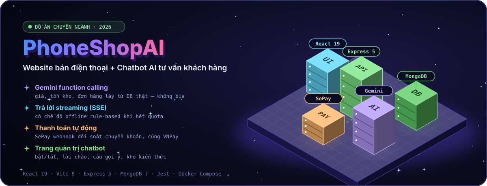
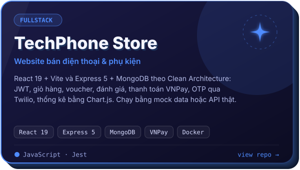
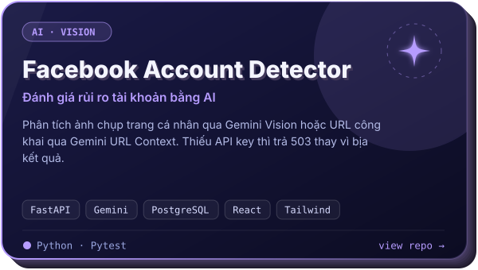
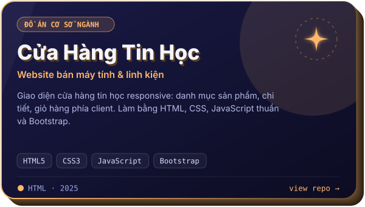
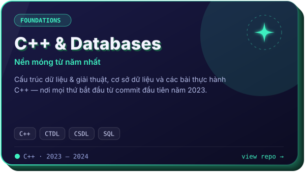
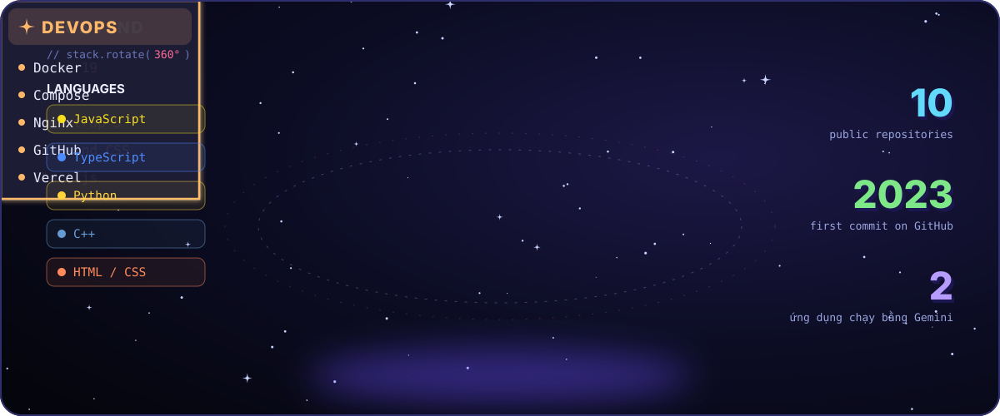
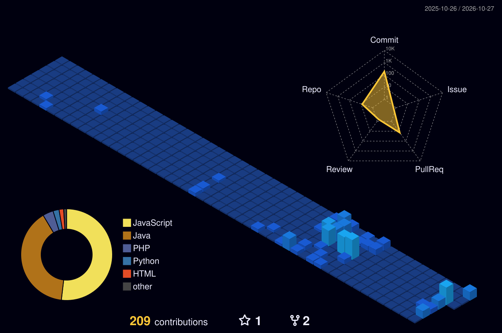

  
  
  
  

 

Xin chào! Mình là **Nguyên**, sinh viên Công nghệ Thông tin tại **Đại học Trà Vinh** (lớp DA23TTA).
Mình thích làm web **fullstack bằng JavaScript** — từ giao diện React đến API Node.js/Express và MongoDB —
và đang dạy cho website của mình biết **tự tư vấn khách hàng bằng AI**.

- 🔭 Đang làm **[PhoneShopAI](https://github.com/TrungNguyen410/cn-da23tta-sontrungnguyen-phoneshopchatbot)** — đồ án chuyên ngành: web bán điện thoại + chatbot Gemini
- 🌱 Đang học sâu về function calling, streaming SSE, đánh giá chất lượng chatbot và Docker
- 💬 Hỏi mình về React, Express, MongoDB, tích hợp Gemini API, thanh toán VNPay / SePay
- ⚡ Fun fact: chiếc điện thoại ở trên là 3D thật — mỗi mặt được chiếu rồi nội suy theo thời gian, không dùng một dòng JavaScript nào trong ảnh

 

  

 

> Khách hỏi *"máy nào dưới 10 triệu, pin trâu?"* — chatbot gọi công cụ tìm sản phẩm trong cơ sở dữ liệu,
> so sánh, rồi trả lời kèm link mua. Giá và tồn kho **luôn là số thật**, không phải do AI tự nghĩ ra.

| | Bài toán | Cách giải |
|:-:|---|---|
| 🤖 | **Tư vấn bằng ngôn ngữ tự nhiên** | Gemini + function calling: tìm sản phẩm, so sánh, tra đơn hàng, đọc kho kiến thức |
| ⚡ | **Trả lời nhanh, không treo** | Streaming qua SSE; hết quota thì tự chuyển sang chế độ offline rule-based |
| 💳 | **Thanh toán không cần đối soát tay** | SePay webhook xác nhận chuyển khoản tự động, cùng VNPay |
| 🛠️ | **Admin làm chủ chatbot** | Bật/tắt, lời chào, câu hỏi gợi ý, quản lý bài viết kiến thức |
| 🧪 | **Đo được chất lượng** | Script `eval:chatbot` chấm bộ câu hỏi mẫu, Jest cho backend |

 

  
  

  
  

 

  

    

   
   
   
  

 

  

 

<table>
<tr>
<td width="50%" valign="top">

### 🎯 Dữ liệu thật, không bịa
Chatbot chỉ trả lời giá, tồn kho, đơn hàng sau khi gọi công cụ đọc database —
thiếu dữ liệu thì nói không biết, chứ không đoán.

</td>
<td width="50%" valign="top">

### 🧩 Clean Architecture
`routes → controllers → services → repositories → models`: mỗi tầng một việc,
đổi database hay AI provider không phải sửa cả dự án.

</td>
</tr>
<tr>
<td width="50%" valign="top">

### 🛟 Luôn có đường lui
Hết quota Gemini thì chuyển sang chế độ offline rule-based; frontend chạy được
bằng mock data khi chưa có backend.

</td>
<td width="50%" valign="top">

### 🧪 Đo trước khi khoe
Jest cho backend, script `eval:chatbot` chấm chatbot trên bộ câu hỏi mẫu —
kết quả lưu lại để so sánh giữa các phiên bản.

</td>
</tr>
<tr>
<td width="50%" valign="top">

### 🐳 Chạy ở đâu cũng được
Docker Compose dựng đủ MongoDB, backend, frontend chỉ bằng một lệnh;
biến môi trường tách bạch cho local, Docker và production.

</td>
<td width="50%" valign="top">

### 📚 Viết tài liệu cho người sau
README tiếng Việt có hướng dẫn cài đặt, tài liệu phân tích thiết kế và báo cáo
tiến độ hằng tuần nằm ngay trong repo.

</td>
</tr>
</table>

 

  <picture>
    <source media="(prefers-color-scheme: dark)" srcset="./profile-3d-contrib/profile-night-view.svg" />
    <source media="(prefers-color-scheme: light)" srcset="./profile-3d-contrib/profile-season-animate.svg" />
    
  </picture>

    

  <picture>
    <source media="(prefers-color-scheme: dark)" srcset="https://raw.githubusercontent.com/TrungNguyen410/TrungNguyen410/output/github-snake-dark.svg" />
    <source media="(prefers-color-scheme: light)" srcset="https://raw.githubusercontent.com/TrungNguyen410/TrungNguyen410/output/github-snake.svg" />
    
  </picture>

 

**Cùng nhau build một thứ gì đó thật xịn nhé!**

